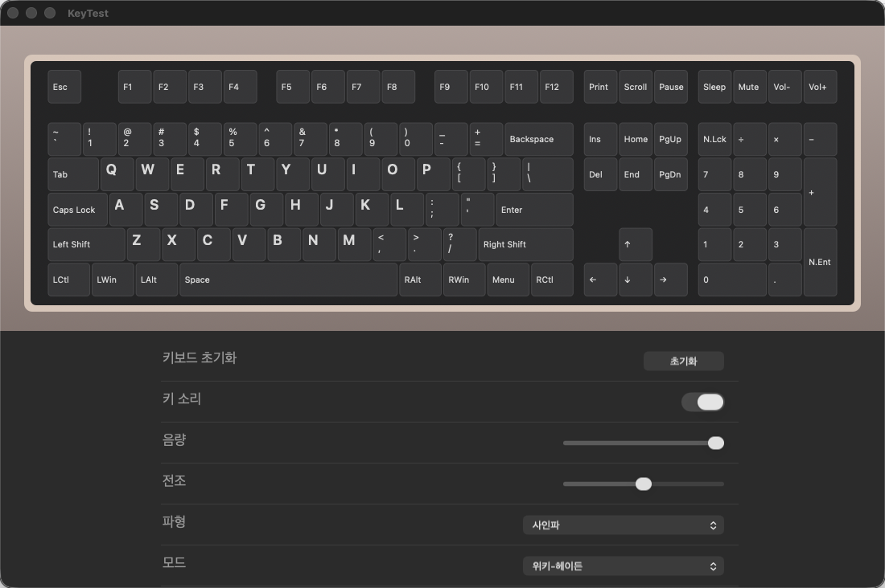

# KeyTest

맥용 키보드 키 테스트 앱입니다. 키를 누르면 화면의 키보드에 불이 들어오고, 소리로도 알려 줍니다. 앱이 활성일 때는 Cmd+Tab 같은 조합키를 시스템으로 보내지 않고 화면에만 켭니다.



> 이 이미지는 앱의 `--snapshot` 모드로 렌더링한 화면입니다. 눌린 키 표시를 보여 주려고 Esc · Enter · N.Ent(눌렀던 키)와 Left Shift · LWin(누르는 중)을 예시로 켰습니다.

## 빠른 설치

Apple Silicon Mac에서 Homebrew로 설치합니다.

```sh
brew install --cask gyuha/tap/keytest
```

설치 후 권한 허용이 필요하고, 자세한 내용과 직접 내려받는 방법은 [설치](#설치)를 보세요.

## 기능

- **키 표시:** 108키 배치에서 누르는 중인 키는 보라색, 한 번 눌렀던 키는 연한 살구색으로 켜집니다. `초기화` 버튼으로 모두 지웁니다.
- **조합키 가로채기:** 앱이 활성일 때 `CGEventTap`으로 키 이벤트를 소비해서 Cmd+Tab 같은 조합키가 외부로 나가지 않게 합니다. 앱이 비활성이면 아무것도 가로채지 않습니다.
- **키 소리:** 키를 처음 누를 때 소리가 납니다. 키를 계속 누르고 있어도, 뗄 때도 울리지 않습니다. 화면을 보지 않고도 눌렸는지 알 수 있습니다.
- **설정 패널:** 키 소리 켜기/끄기, 음량, 전조(±12반음), 파형(사인·사각·톱니·삼각), 모드(위키-헤이든·단일음)를 바꿀 수 있고 저장됩니다.

## 키 대응

이미지의 키 이름과 맥 키는 이렇게 대응합니다.

| 화면 표시 | 맥 키 |
|---|---|
| Alt (LAlt · RAlt) | Option |
| Win (LWin · RWin) | Command |
| Print · Scroll · Pause | F13 · F14 · F15 |
| Ins · Del | Help · Forward Delete |
| N.Lck | 키패드 Clear |
| Menu | Fn |
| Mute · Vol- · Vol+ | 미디어 키 |
| Sleep | 대응 키 없음 (켜지지 않음) |

그래서 Alt+Tab은 맥에서 **Cmd+Tab**입니다.

## 설치

### Homebrew (권장)

Apple Silicon Mac에서 [자체 Homebrew tap](https://github.com/gyuha/homebrew-tap)으로 설치합니다.

```sh
brew install --cask gyuha/tap/keytest
```

tap을 먼저 등록해 두고 짧은 이름으로 설치해도 됩니다.

```sh
brew tap gyuha/tap
brew install --cask keytest
```

설치하면 `/Applications/KeyTest.app`이 생깁니다. 아래 [권한](#권한)을 허용한 뒤 앱을 실행하세요.

- 서명·공증을 하지 않은 앱이라, Homebrew로 설치하면 설치 직후 이 앱에 한해 macOS의 격리 표시(`com.apple.quarantine`)를 지워 경고 없이 열립니다. 이 검사를 우회하는 것이므로 출처를 신뢰하는 경우에만 설치하세요.
- Apple Silicon(arm64)과 macOS 13 이상만 지원합니다. Intel Mac이나 macOS 13 미만에서는 Homebrew가 설치를 거부합니다.

업데이트와 제거는 이렇게 합니다. 앱 안에 업데이트 기능이 없으므로 새 버전은 Homebrew로 받습니다.

```sh
brew update && brew upgrade --cask keytest   # 업데이트
brew uninstall --cask keytest                # 제거
```

업데이트로 앱이 바뀌면 아래 [권한](#권한) 허용을 다시 해야 할 수 있습니다.

### 직접 내려받기

[Releases](https://github.com/gyuha/keyboard-test/releases)에서 `KeyTest.dmg`를 받아 `KeyTest.app`을 Applications로 옮기세요.

- 서명이 ad-hoc이고 공증(notarization)이 안 돼 있어서 처음 열 때 "확인되지 않은 개발자" 경고가 뜹니다. 우클릭 → 열기로 허용하세요.

### 권한

- 조합키를 가로채려면 **시스템 설정 → 개인정보 보호 및 보안**에서 `KeyTest`에 **손쉬운 사용**과 **입력 모니터링**을 허용하고 앱을 다시 실행해야 합니다. 권한이 없으면 창 위쪽에 안내가 뜨고, 이 앱 창 안에서 누른 키만 켜집니다.

## 사용 시 주의

- 앱이 활성일 때는 Cmd+Q도 가로채집니다. 종료는 창 닫기 버튼, 메뉴의 `KeyTest 종료`(마우스), 비상 종료 **⌃⌥⌘Q**로 합니다.
- 실제 Cmd+Tab 차단은 자동 테스트로 검증하지 못했습니다. 이벤트 탭 설정과 소비 판단은 합성 이벤트로만 확인했고, 권한을 승인한 환경에서 직접 확인이 필요합니다.

## 빌드

Swift 툴체인(Command Line Tools면 충분)과 macOS 13 이상이 필요합니다. [Task](https://taskfile.dev)를 쓰면 편합니다.

| 명령 | 하는 일 |
|---|---|
| `task build` | 디버그 빌드 |
| `task test` | 체크 러너 전체 실행 |
| `task app` | `build/KeyTest.app` 생성 (ad-hoc 서명) |
| `task run` | 앱 번들을 만들고 실행 |
| `task dev` | 번들 없이 디버그 바이너리로 바로 실행 |
| `task dmg` | `build/KeyTest.dmg` 생성 |
| `task snapshot` | 화면을 PNG로 렌더링 (`task snapshot -- out.png`로 경로 지정) |
| `task clean` | `.build`와 `build` 삭제 |

Task 없이는 `swift build`, `swift run keytest-checks`, `bash scripts/build-app.sh`, `bash scripts/build-dmg.sh`를 직접 실행하면 됩니다.

## 배포

새 버전은 한 번에 배포합니다. DMG를 빌드해 GitHub 릴리스(`v<버전>` 태그)로 공개하고, 이어서 [homebrew-tap](https://github.com/gyuha/homebrew-tap)의 `keytest` Cask(version·sha256)를 새 버전으로 바꿔 push합니다. `gh` 로그인과 tap 저장소 push 권한이 필요합니다.

```sh
task release -- 0.2.0     # = bash scripts/release.sh 0.2.0 [릴리스 노트 파일]
```

공개는 되돌릴 수 없어서 먼저 점검합니다: `main` 브랜치, 추적 파일 변경 없음, `origin/main`과 같은 커밋(push 완료), 아직 없는 태그. 노트 파일을 주지 않으면 GitHub가 커밋 기록으로 노트를 만듭니다.

```
점검 → DMG 빌드(앱 버전 반영) → GitHub 릴리스 공개 → 공개된 DMG를 다시 받아 sha256 대조 → tap Cask 갱신·push
  ↓ 실패
시작하지 않고 종료
```

- 릴리스는 공개됐는데 tap 갱신만 실패했다면 `task tap -- 0.2.0`(= `bash scripts/update-tap.sh 0.2.0`)으로 다시 실행하세요. 이미 반영돼 있으면 아무것도 바꾸지 않습니다.
- `DRY_RUN=1 bash scripts/update-tap.sh <버전>`은 Cask 변경을 커밋까지만 하고 push하지 않습니다.
- 설치한 사람은 `brew update && brew upgrade --cask keytest`로 받습니다.

## 구조

키 이벤트는 순수 로직을 거쳐 화면과 소리에 반영됩니다.

```
키 이벤트 → 이벤트 탭 → EventTapPolicy.decide → 소비 또는 통과
                              ├→ KeyState (켜짐 기록) → 화면
                              └→ 새로 눌린 키 → SoundTrigger → 소리
```

| 위치 | 역할 |
|---|---|
| `Sources/KeyTestCore` | 화면과 무관한 순수 로직: 레이아웃, 키 상태, 이벤트 탭 판단, 소리 설정·합성 |
| `Sources/KeyTest` | AppKit 앱: 키보드 뷰, 설정 패널, 이벤트 탭 설치, 오디오 재생 |
| `Sources/keytest-checks` | 자체 체크 러너 (Layout · KeyState · EventTap · Sound 스위트) |
| `scripts/` | 앱 번들·DMG 빌드 스크립트 |

Xcode가 없는 환경에서도 돌도록 XCTest 대신 자체 체크 러너를 씁니다. 스위트는 `swift run keytest-checks --suite Layout`처럼 하나씩 실행할 수도 있고, 하나라도 실패하면 exit 1로 끝납니다.
