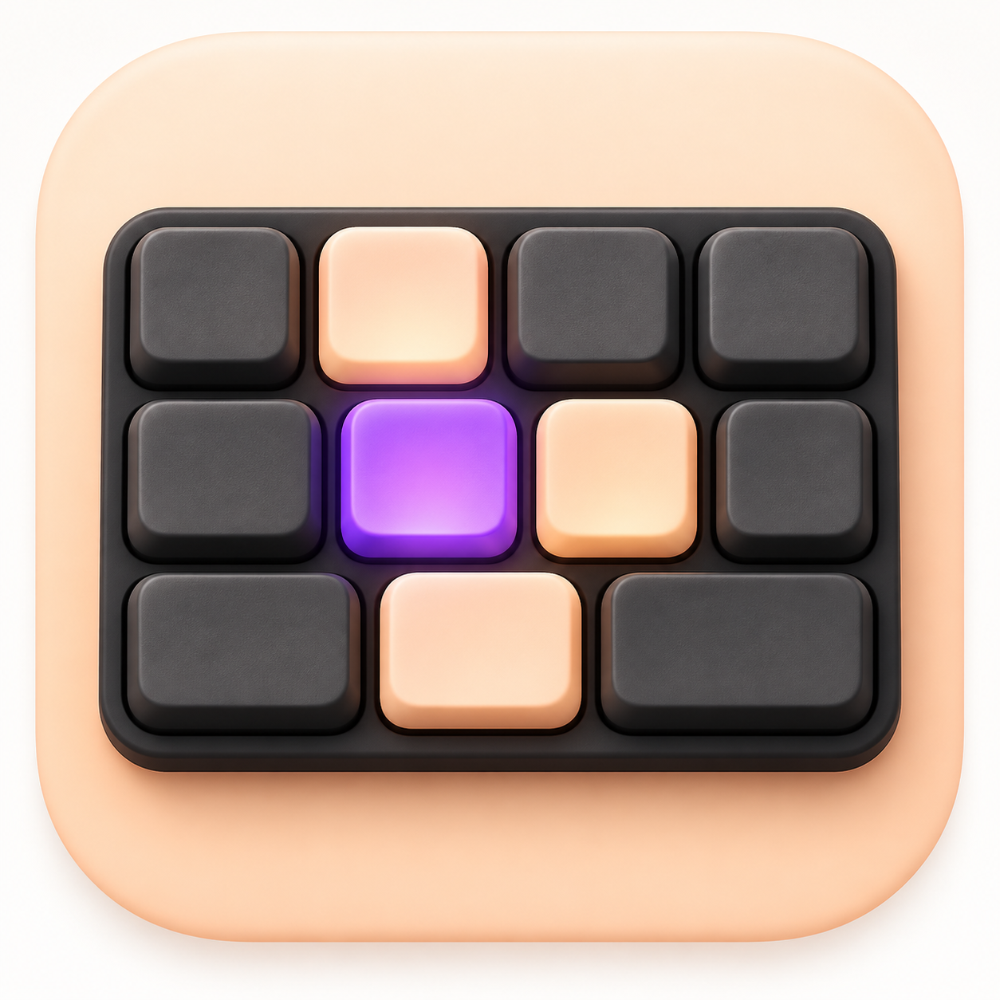
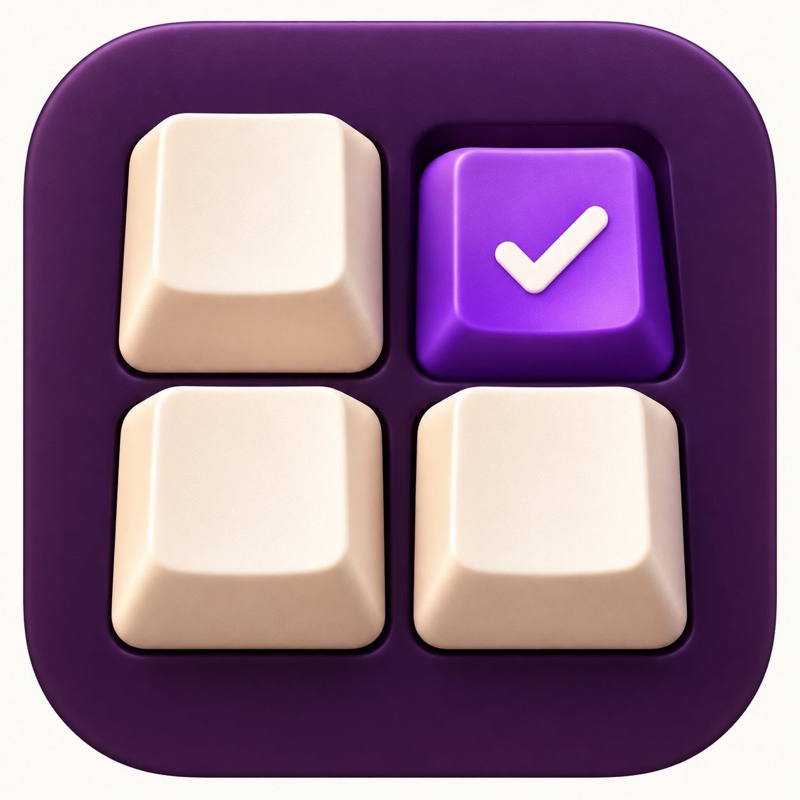
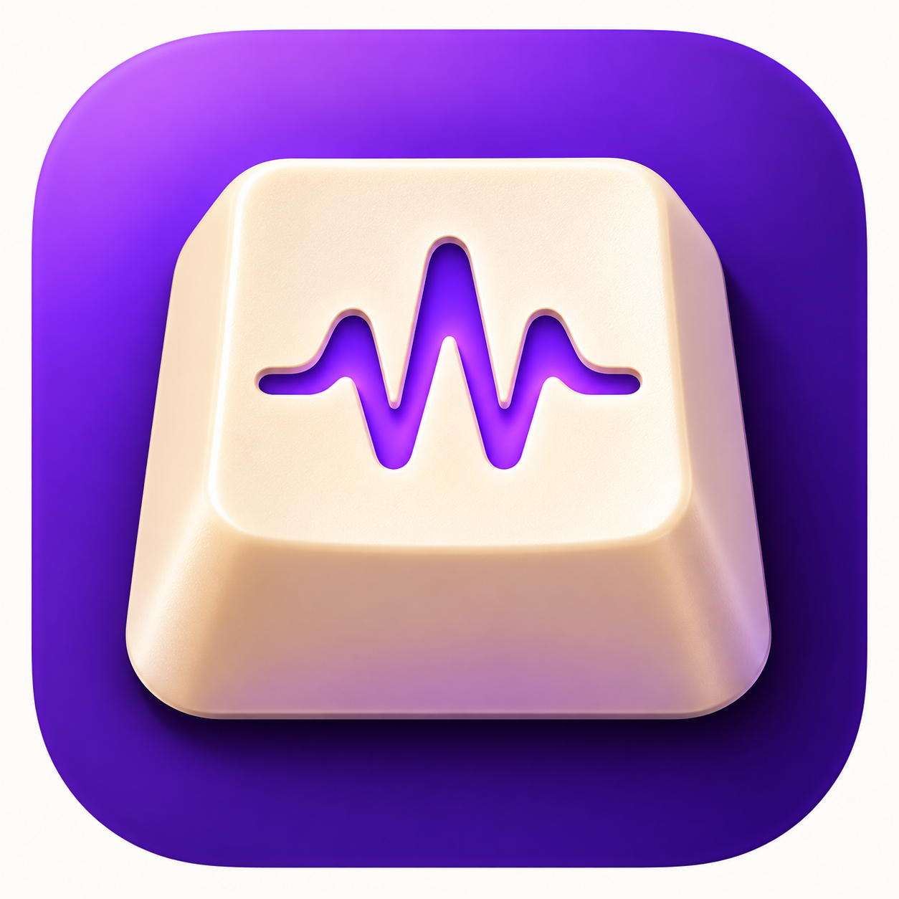
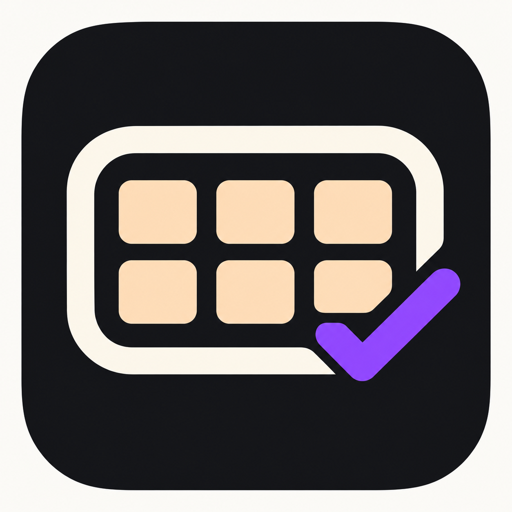
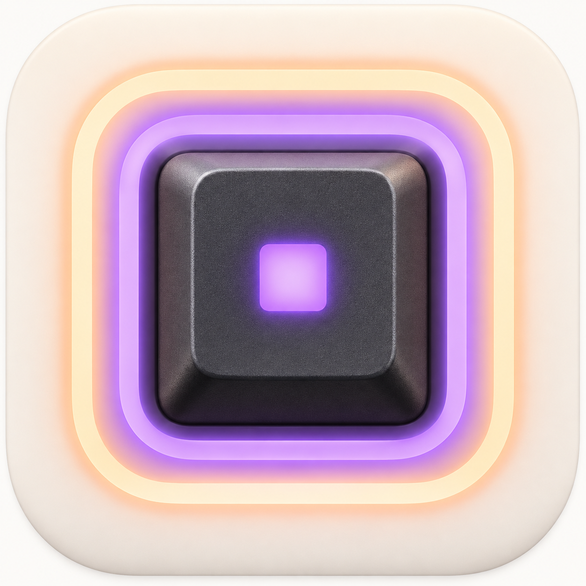

# KeyTest 아이콘 시안

내장 image_gen 도구로 생성한 6개 시안입니다. 앱 적용 전 비교용 PNG입니다.

## 공통 프롬프트

Use case: logo-brand. Asset type: macOS app icon concept for KeyTest, a keyboard testing utility that lights pressed keys violet and tested keys pale peach and plays tones. Create ONE polished standalone square app icon, 1024x1024. Large central symbol legible at small Dock sizes, generous safe margins, rounded-square icon tile filling most of image on a neutral off-white outer canvas. No words, letters, numbers, captions, watermark, mockup devices, or presentation board. Crisp professional crafted icon design. 

## 01-violet-keycap

A single large tactile violet mechanical keyboard keycap viewed almost front-on with very subtle top-down depth, a clean warm-white checkmark recessed into its face. Dark charcoal rounded-square tile. Soft precise edge lighting, subtle bevels, minimal premium macOS utility aesthetic. Strong iconic silhouette, no extra symbols.

## 02-keyboard-peach

Compact stylized keyboard with only three rows of oversized charcoal rounded keys, top-down view on a warm pale peach rounded-square tile. One central key glows vivid violet; a few tested keys are light peach. Geometric, quietly tactile, tiny contact shadows, no key legends. The keyboard fills 70 percent width and remains recognizable at small size.

## 03-test-grid

A tightly composed 2 by 2 cluster of four chunky sculpted keycaps, three warm ivory and one vivid violet depressed key with a tiny white checkmark, on a deep aubergine rounded-square tile. Mostly orthographic, restrained dimensional depth, premium ceramic-like matte finish, generous spacing. Bold minimal composition.

## 04-key-pulse

One warm ivory sculptural keycap with a simple violet sound pulse waveform engraved across its face, on a rich violet rounded-square tile with a subtle tonal gradient. Front-top three-quarter view but nearly symmetrical, soft believable shadows. Express keyboard input becoming sound, only one keycap and one simple three-peak pulse motif. Modern macOS crafted material icon.

## 05-checked-outline

Very minimal graphic icon: a clean thick ivory outline of a keyboard formed from one broad rounded rectangle and six large tiny key shapes, with its bottom-right corner merging seamlessly into a bold violet checkmark. Near-black charcoal rounded-square tile. Flat vector-like geometry, no photorealism, no 3D, sharp high contrast, refined optical balance.

## 06-key-ripple

A single dark graphite keycap seen from directly above, surrounded by two concentric rounded-square violet and pale peach signal rings representing keypress detection. Warm off-white rounded-square tile, subtle soft tactile depth and contact shadows. Keycap center has a single small luminous violet square, no text. Symmetrical quiet elegant composition with an unmistakable key silhouette.

